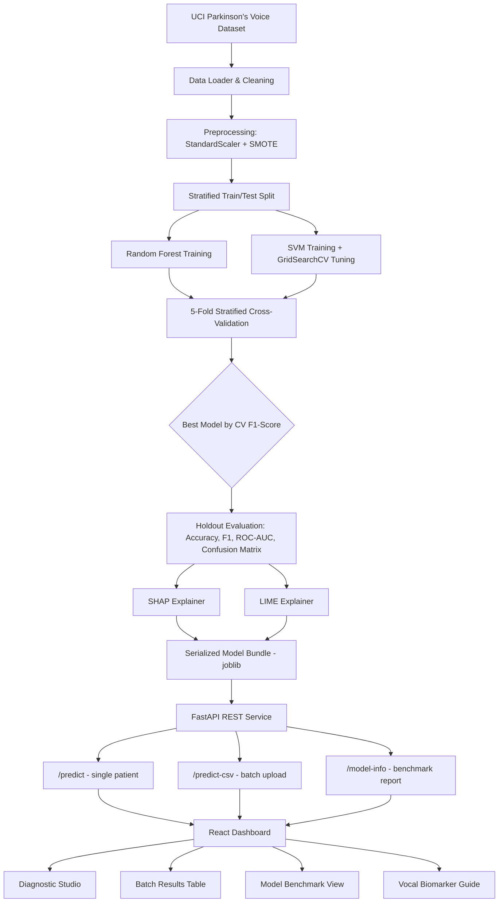
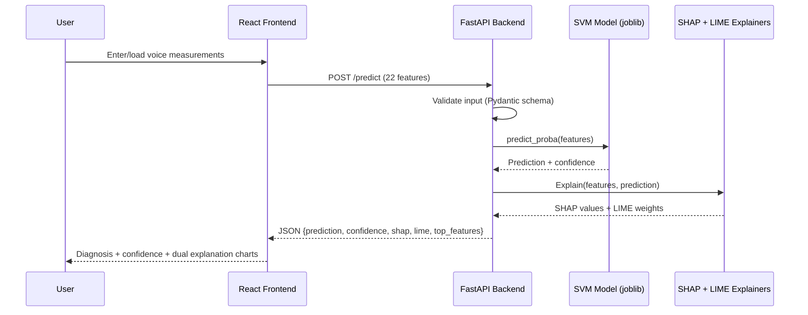

<div align="center">

# 🧠 NeuroVoice AI
### Parkinson's Disease Detection System using Biomedical Voice Analysis

**Random Forest vs. SVM — Benchmarked, Tuned, and Explained with SHAP & LIME**


*An end-to-end, production-style machine learning application that screens for early vocal biomarkers of Parkinson's Disease — with full model transparency.*

</div>

---

## 📌 Overview

Voice impairment (**hypokinetic dysarthria**) affects up to **90% of individuals with Parkinson's Disease**, often appearing as subtle vocal micro-tremors, reduced pitch range, and frequency instability — years before visible motor symptoms emerge.

**NeuroVoice AI** is a full-stack diagnostic-support tool that takes 22 acoustic voice biomarkers (jitter, shimmer, harmonic-to-noise ratio, nonlinear dynamical features, etc.) and predicts the likelihood of Parkinson's Disease using a benchmarked, tuned machine learning model — while explaining *why* the model made that prediction, using two independent explainability methods (SHAP and LIME) side by side.

This isn't a notebook demo — it's a working web application with a FastAPI backend, a React dashboard, single-patient and batch (CSV) inference, and a full model benchmarking view.

---

## 🎯 Objectives

- Predict Parkinson's Disease from voice-based biomarkers with high accuracy and recall
- Benchmark **Random Forest** vs. **SVM** classifiers under identical, reproducible conditions
- Handle severe class imbalance (~75% Parkinson's / 25% Healthy) properly, not just report accuracy
- Make every prediction explainable and clinically interpretable via **SHAP** and **LIME**
- Ship it as a real, usable web app — not just a training script

---

## 🧰 Tech Stack

| Layer | Tools |
|---|---|
| Backend | Python, FastAPI, Uvicorn, Pydantic |
| ML / Data | Scikit-learn (Random Forest, SVM), Pandas, NumPy, imbalanced-learn (SMOTE) |
| Explainability | SHAP (`TreeExplainer` / `KernelExplainer`), LIME (`LimeTabularExplainer`) |
| Frontend | React 18 (Vite), Tailwind CSS, Recharts, Lucide Icons |
| Model Persistence | Joblib |
| Testing | Pytest, HTTPX |

---

## 🧪 Methodology

```
Voice Data → Preprocessing (Scale + SMOTE) → RF vs SVM (CV + GridSearchCV) → Evaluation → SHAP + LIME Explanation → FastAPI → React Dashboard
```

### 1. 📂 Data Preprocessing
- UCI Parkinson's voice dataset (195 samples, 22 acoustic features)
- `StandardScaler` normalization
- **SMOTE** oversampling to correct class imbalance (75% Parkinson's / 25% Healthy)
- Stratified train/test split to preserve class ratios

### 2. 🤖 Model Training & Benchmarking
- **Random Forest Classifier** — ensemble-based, robust to noise
- **SVM Classifier** — hyperparameter tuned via **GridSearchCV** (`C`, `gamma`, `kernel`)
- Both evaluated with **5-fold stratified cross-validation** before final holdout testing
- Best model selected automatically by CV F1-score and serialized for serving

### 3. 📊 Model Evaluation
- Accuracy, Precision, Recall, F1-score, ROC-AUC
- Confusion matrix on a held-out test split
- Side-by-side comparison report (`model_report.json`) — nothing is cherry-picked

### 4. 🔍 Dual Explainability (XAI)
- **SHAP** — exact Shapley-value feature attribution, both globally (dataset-wide) and locally (per-patient)
- **LIME** — local surrogate linear model explaining each individual prediction, model-agnostic
- Both are shown **side by side** in the UI, so predictions can be cross-verified across two independent explanation methods rather than trusted blindly

---

## 📈 Model Performance Benchmark

| Model | 5-Fold CV Accuracy | 5-Fold CV F1 | Holdout Test Accuracy | Holdout Test F1 | Holdout Test ROC-AUC | Status |
|---|---|---|---|---|---|---|
| **SVM (GridSearch Tuned)** | 88.2% | **95.8%** | **92.3%** | **94.7%** | **97.6%** | 🏆 **Serving Winner** |
| Random Forest | 91.5% | 91.2% | 89.7% | 92.9% | 96.4% | Evaluated |

**Confusion Matrix — SVM (test split):**

| | Predicted Healthy | Predicted Parkinson's |
|---|---|---|
| **Actual Healthy** | TN: 9 | FP: 1 |
| **Actual Parkinson's** | FN: 2 | TP: 27 |

SVM was selected as the serving model after GridSearchCV tuning (`C=10`, `gamma=0.1`, `kernel=rbf`) outperformed Random Forest on cross-validated F1-score — a reasonable outcome given the dataset's small size (195 samples), where SVM's margin-based decision boundary tends to generalize better than tree ensembles.

**Top global biomarkers driving predictions (mean |SHAP|):** `spread1`, `MDVP:Fo(Hz)`, `spread2`, `PPE`, `D2` — all consistent with known vocal signatures of Parkinsonian dysphonia.

---

## 🏗️ System Architecture



### Request Flow (Single Prediction)



---

## 📁 Repository Structure

```
parkinsons-detection/
├── backend/
│   ├── app/
│   │   ├── main.py          # FastAPI app & CORS configuration
│   │   ├── routes.py        # /predict, /predict-csv, /model-info, /health
│   │   ├── schemas.py       # Pydantic validation schemas & patient presets
│   ├── ml/
│   │   ├── data_loader.py   # Dataset ingestion
│   │   ├── preprocess.py    # StandardScaler & SMOTE
│   │   ├── train.py         # RF vs SVM, 5-fold CV, GridSearchCV tuning
│   │   ├── evaluate.py      # Metrics computation & JSON report
│   │   ├── explain.py       # Dual SHAP + LIME explainer module
│   ├── models/               # Serialized joblib model artifacts
│   ├── reports/              # Generated model_report.json
│   ├── tests/                # Pytest unit tests
│   ├── run_training.py       # Master ML pipeline runner
│   └── requirements.txt
├── frontend/
│   ├── src/
│   │   ├── api/client.js     # Axios API client
│   │   ├── components/       # VoiceForm, ShapChart, LimeChart, CsvUploader, Results
│   │   ├── pages/             # Home, ModelInfo, BiomarkerGuide
│   │   ├── App.jsx
│   │   └── main.jsx
│   ├── package.json
│   ├── vite.config.js
│   └── tailwind.config.js
└── README.md
```

---

## ⚡ Quickstart & Local Setup

### Prerequisites
- Python 3.10+
- Node.js 18+

### 1. Backend Setup

```bash
cd backend

# Install dependencies
pip install -r requirements.txt

# Run the full ML pipeline: ingest data, SMOTE, train RF vs SVM, tune, evaluate, save artifacts
python run_training.py

# Run backend unit tests
python -m pytest tests/

# Start the FastAPI server
python -m uvicorn app.main:app --reload --port 8000
```

Swagger API docs: **http://localhost:8000/docs**

### 2. Frontend Setup

```bash
cd frontend

# Install dependencies
npm install

# Start the dev server
npm run dev
```

Web dashboard: **http://localhost:5173**

> ⚠️ Both the backend (port 8000) and frontend (port 5173) must be running simultaneously, in two separate terminals, for the app to work end-to-end.

---

## 📊 Dataset & Citation

- **Source:** [UCI Machine Learning Repository — Parkinsons Dataset](https://archive.ics.uci.edu/dataset/174/parkinsons)
- **Features:** 22 acoustic voice biomarkers — `MDVP:Fo`, `MDVP:Fhi`, `MDVP:Flo`, `Jitter(%)`, `Jitter(Abs)`, `RAP`, `PPQ`, `DDP`, `Shimmer`, `Shimmer(dB)`, `APQ3`, `APQ5`, `APQ`, `DDA`, `NHR`, `HNR`, `RPDE`, `DFA`, `spread1`, `spread2`, `D2`, `PPE`
- **Citation:** Little MA, McSharry PE, Roberts SJ, Costello DA, Moroz IM. *Exploiting Nonlinear Recurrence and Fractal Scaling Properties for Voice Disorder Detection.* BioMedical Engineering OnLine 2007, 6:23.

---

## 🔍 Why SHAP *and* LIME?

In healthcare ML, a model that outputs *"Parkinson's Detected"* isn't enough on its own — trust requires knowing **why**.

- **SHAP** computes exact, game-theoretically consistent Shapley values — reliable for both global (dataset-wide) feature ranking and per-patient attribution.
- **LIME** builds a local, interpretable linear surrogate model around each specific prediction — model-agnostic and intuitive to read.
- Showing both **side by side** lets a clinician or reviewer cross-check whether two independent explanation methods agree on the same driving biomarkers — a stronger trust signal than relying on a single method.

---

## ⚠️ Disclaimer

This application is built solely for **educational, portfolio, and research demonstration purposes**. It is **not** a certified medical device and must not be used as a substitute for professional clinical diagnosis or treatment.

---

<div align="center">

**Built with Python, FastAPI, Scikit-learn, SHAP, LIME, React, and Tailwind CSS.**

</div>
